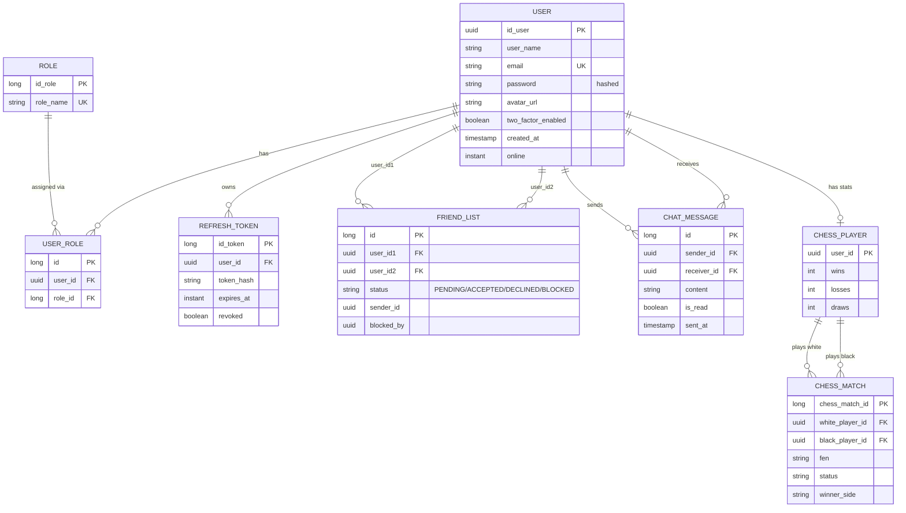

*This project has been created as part of the 42 curriculum by ebansse, rjacquet, , <login4>.*

<!-- ⚠️ Replace the logins above with your real 42 intra logins before submitting — required verbatim format. -->

# Transcendence

## Description

Transcendence is a full-stack, real-time multiplayer web application built around a live chess platform. Users can register, manage their profile and avatar, add and block friends, chat in real time, and play chess against each other or against an AI opponent, with match history and statistics tracked per account.

Key features:
- Secure user management: email/password authentication with hashed passwords, optional Two-Factor Authentication (TOTP), and login via 42 OAuth
- Single active session per account: logging in from a new device revokes any previous session
- Friend system with online presence, and a block system that never reveals a block suffered by the user (only blocks the user issued)
- Real-time chat over WebSocket (STOMP/SockJS)
- A full chess platform: live matches, an AI opponent with its own evaluation engine and opening book, disconnect/reconnect handling, match history and per-player statistics
- Admin user management (view/edit/delete accounts, role management)
- HTTPS-only deployment behind nginx, fully containerized with Docker Compose

## Instructions

### Prerequisites

- [Docker](https://www.docker.com/products/docker-desktop/) and Docker Compose (`docker compose version`)
- A registered OAuth application on the [42 intra](https://profile.intra.42.fr/oauth/applications/new), if you want to test login via 42

Everything else (Java, Maven, Node, PostgreSQL) runs inside containers — you do not need them installed locally to run the project.

### Setup

1. Copy the environment template and fill in real values:
   ```bash
   cp .env.example .env
   ```
   Required variables:
   | Variable | Description |
   |---|---|
   | `POSTGRES_DB` / `POSTGRES_USER` / `POSTGRES_PASSWORD` | PostgreSQL credentials |
   | `SPRING_DATASOURCE_URL` / `_USERNAME` / `_PASSWORD` | Backend datasource (local dev only — inside Docker the backend talks to the `db` service directly) |
   | `OAUTH42_CLIENT_ID` / `OAUTH42_CLIENT_SECRET` | From your 42 OAuth app |
   | `OAUTH42_REDIRECT_URI` | Must exactly match the Redirect URI registered on the 42 app — `https://localhost/api/auth/42/callback` for local use |
   | `OAUTH42_FRONTEND_REDIRECT_URI` | Where the browser lands after a 42 login — `https://localhost/` for local use |
   | `JWT_SECRET` | Signing key for access tokens. Generate one with `openssl rand -base64 32` — never reuse the example value |
   | `FRONTEND_ORIGIN` | Origin allowed to open the WebSocket connection — `https://localhost` for local use |

2. Launch everything with a single command:
   ```bash
   make
   ```
   This builds and starts three containers: `nginx` (TLS termination + reverse proxy + serves the built frontend), `backend` (Spring Boot), and `db` (PostgreSQL).

3. Open **https://localhost/** in your browser. The TLS certificate is self-signed for local use, so the browser will warn you once — accept it to continue.

### Other useful commands

| Command | Effect |
|---|---|
| `make` / `make up` | Build (if needed) and start the stack |
| `make down` | Stop the stack |
| `make re` | Restart everything (`down` + `up --build`) — needed after a code change or a `.env` change, since `docker compose restart` alone does **not** re-read `.env` |
| `make logs` | Follow logs from all containers |
| `make ps` | List running containers |
| `make clean` / `make fclean` | Tear down and remove images (`fclean` also removes the database volume — this deletes all data) |

### Testing the API

You can test the backend endpoints directly with Postman. Example, once the stack is running:
```
POST https://localhost/api/auth/register
Content-Type: application/json

{
  "userName": "john_doe",
  "email": "john@example.com",
  "password": "password123",
  "confirmedPassword": "password123"
}
```
Login sets `access_token`/`refresh_token` as `HttpOnly`, `Secure`, `SameSite=strict` cookies — Postman's cookie jar handles them automatically across requests to the same domain.

## Resources

- [Spring Boot reference documentation](https://docs.spring.io/spring-boot/index.html)
- [Spring Security reference documentation](https://docs.spring.io/spring-security/reference/index.html)
- [Spring Data JPA reference documentation](https://docs.spring.io/spring-data/jpa/reference/index.html)
- [JJWT](https://github.com/jwtk/jjwt) — JWT issuing/parsing library used for access tokens
- [Chess Programming Wiki](https://www.chessprogramming.org/) — piece-square tables, board evaluation and opening book concepts used by the AI opponent
- [42 API documentation](https://api.intra.42.fr/apidoc) — OAuth2 authorization code flow
- [React documentation](https://react.dev/)
- [nginx documentation](https://nginx.org/en/docs/) — reverse proxy and TLS termination configuration

**Use of AI:** Claude (Anthropic) was used throughout development, but mainly as a learning and support tool rather than to write core logic. The actual implementation code was written by the team members, with Claude used for explaining concepts, writing comments and Javadoc, reviewing code for bugs before it was committed, and running end-to-end tests/debugging — including live HTTP requests against the running Docker stack, and diagnosing an environment issue. No AI-generated logic was copy-pasted without being understood first.

<!-- ⚠️ Add here how AI was used for the parts of the project done outside this session (chess engine/AI bot, chat, 2FA, containerization/nginx setup, frontend), if applicable, so this section reflects the whole team's work, not just one contributor's. -->

## Team Information

<!-- ⚠️ PLACEHOLDER — fill in for each team member. -->

| Member | Role(s) | Responsibilities |
|---|---|---|
| `<login>` | `[Product Owner / Project Manager / Tech Lead / Developer]` | `[...]` |
| `<login>` | `[...]` | `[...]` |
| `<login>` | `[...]` | `[...]` |
| `<login>` | `[...]` | `[...]` |

## Project Management

<!-- ⚠️ PLACEHOLDER — describe how the team actually worked. -->

- **Task organization:** `[e.g. GitHub Issues / Trello board, one ticket per feature (TRA-XX branches), task distribution during weekly syncs]`
- **Communication channel:** `[e.g. Discord]`
- **Meeting cadence:** `[e.g. weekly / bi-weekly syncs]`
- **Code review:** `[describe your review process, if any]`

## Technical Stack

**Frontend**
- React 19 + TypeScript, built with Vite
- React Router for SPA navigation
- `chess.js` for client-side chess rules
- `@stomp/stompjs` + `sockjs-client` for the WebSocket/STOMP connection (chat, live chess moves, presence)

**Backend**
- Spring Boot 4.1 (Java 21)
- Spring Security — stateless, JWT-based authentication (no server-side session), a custom filter validates the access token cookie on every request
- Spring Data JPA / Hibernate — ORM over PostgreSQL
- Spring WebSocket (STOMP over SockJS) — chat, live chess moves, presence broadcasting
- `jjwt` — JWT issuing and verification
- `totp` — Two-Factor Authentication code generation/verification
- `dotenv-java` — loads `.env` for local (non-Docker) runs

**Database**
- PostgreSQL 17 — relational database, chosen for the strongly relational nature of the data (users ↔ roles, users ↔ friend relationships, users ↔ chess matches) and Spring Data JPA's first-class support for it.

**Deployment**
- Docker Compose orchestrating three services: `nginx` (TLS termination, reverse proxy, serves the built frontend), `backend`, `db`
- nginx is the single public entry point (`https://localhost/`, port 443 only) — HTTP is not reachable from outside the Docker network, so browser cookies can safely use the `Secure` flag
- `nginx` proxies `/api/*` and `/ws` to the backend, and serves the compiled frontend for every other route (client-side routing handled by React Router)

## Database Schema



`FRIEND_LIST` stores a single row per pair of users (the lower UUID always in `user_id1`), with `status` covering friend requests, acceptance, decline, and blocks — `blocked_by` records which side blocked the other, so a suffered block is never exposed to the blocked user's own `GET /friend-list` response.

## Features List

<!-- ⚠️ Fill in the "Contributor(s)" column — left blank here since it can't be inferred reliably from git history alone (merges attribute commits inconsistently). -->

| Feature | Description | Contributor(s) |
|---|---|---|
| Registration / Login | Email+password auth, hashed passwords, JWT access + refresh tokens as HttpOnly cookies | `[...]` |
| Single active session | A new login revokes the previous session's refresh token | `[...]` |
| 2FA (TOTP) | Optional authenticator-app based two-factor authentication | `[...]` |
| 42 OAuth login | "Sign in with 42", account auto-created on first login | `[...]` |
| Profile management | View/update username and email, avatar upload with a default avatar | `[...]` |
| Friend system | Send/accept/decline requests, remove friends, online presence | `[...]` |
| Block system | Block/unblock, direction-aware (a suffered block is never exposed) | `[...]` |
| Real-time chat | WebSocket-based messaging, chat history | `[...]` |
| Chess — live matches | Real-time chess between two players, full rule enforcement | `[...]` |
| Chess — AI opponent | Bot with board evaluation, opening book and piece-square tables | `[...]` |
| Chess — reconnection | Handles disconnects/reconnects during a live match | `[...]` |
| Chess — stats & history | Per-player win/loss/draw record and match history | `[...]` |
| Admin panel | View/edit/delete any account, role management | `[...]` |
| Privacy Policy / Terms of Service | Accessible legal pages | `[...]` |

## Modules

<!-- ⚠️ DRAFT — this mapping is my best read of the code, not a final claim. Confirm every line against the actual subject module list before submitting, especially "Remote players" (needs explicit latency/disconnect handling, not just reconnection logic) and add justification text for any custom "Modules of choice". Point total below is well above the required 14, which gives margin if some lines are not validated during evaluation. -->

| Category | Module | Type | Points |
|---|---|---|---|
| Web | Frontend + backend frameworks (React + Spring Boot) | Major | 2 |
| Web | Real-time features (WebSocket: chat, chess, presence) | Major | 2 |
| Web | User interaction (chat, profile, friends) | Major | 2 |
| Web | ORM (Spring Data JPA / Hibernate) | Minor | 1 |
| User Management | Standard user management (profile, avatar, friends, presence) | Major | 2 |
| User Management | Remote authentication via 42 OAuth 2.0 | Minor | 1 |
| User Management | Advanced permissions system (admin CRUD, roles) | Major | 2 |
| User Management | 2FA | Minor | 1 |
| User Management | Game statistics & match history (chess) | Minor | 1 |
| Artificial Intelligence | AI opponent for chess | Major | 2 |
| Gaming and UX | Complete web-based game (chess) | Major | 2 |
| Gaming and UX | Remote players (disconnect/reconnect handling) | Major | 2 |
| **Total (draft)** | | | **20** |

## Individual Contributions

<!-- ⚠️ PLACEHOLDER — raw commit counts below (git shortlog) are NOT a fair measure of contribution (a huge refactor is one commit, ten typo fixes are ten) — replace with a real description of what each person built and any challenges they overcame. -->

| Member | Commits (raw count, not a contribution measure) |
|---|---|
| `<login>` | `[...]` |
| `<login>` | `[...]` |
| `<login>` | `[...]` |
| `<login>` | `[...]` |

`[For each member: specific features/modules/components they implemented, and any notable challenges and how they were resolved.]`
